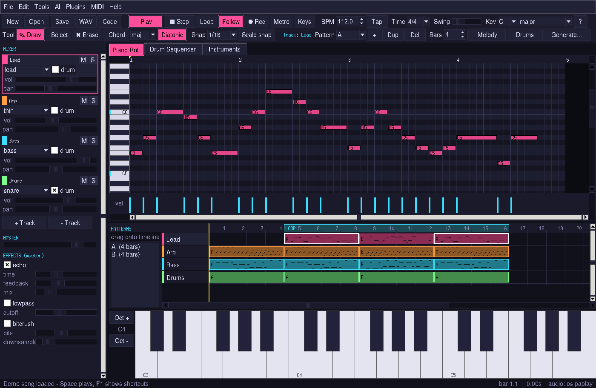

# 8Bit Music Code Studio

[](https://github.com/RechargedIdeas/8bit-music-code-studio/actions/workflows/ci.yml)
[](LICENSE)

A chiptune studio in **one Python file**, `8BitMusicCodeStudio.py`. It has a Tkinter GUI and a NumPy synth, and every sound is synthesized (no samples).
- **Exports:** music goes out as audio (WAV/OGG/MP3/FLAC) or as code: Python, a JavaScript Web Audio module, JSON, or a compact `.8bt` text score.
- **Ops:** the same engine is a set of intent ops (`compose`, `remix`, `loopify`, `soundpack`, `master`, `critique`…). You can drive them from the `8bms` CLI, a terminal studio, Python, HTTP, MCP or ACP.
- **Platforms:** Linux, macOS and Windows; Python 3.10–3.13.



> **Two ways in.**
> **For humans:** install, then run `8bms` for the GUI or `8bms studio` for the terminal studio, and see [getting started](docs/getting-started.md).
> **For agents:** read [AGENTS.md](AGENTS.md) and [llms.txt](llms.txt), list tools with `8bms tools`, and connect over [MCP](docs/mcp.md), [ACP](docs/acp.md) or [HTTP](docs/http-api.md).

## Install

| OS | One line |
|---|---|
| Linux / macOS | `curl -fsSL https://raw.githubusercontent.com/RechargedIdeas/8bit-music-code-studio/main/install.sh \| sh` |
| Windows (PowerShell) | `irm https://raw.githubusercontent.com/RechargedIdeas/8bit-music-code-studio/main/install.ps1 \| iex` |

The one-liners fetch from `raw.githubusercontent.com`, so they work only while the repository is public. For a private checkout, run the script from your clone instead: `sh install.sh --source .` or `.\install.ps1 -Source .`.

The installer:
- checks for Python 3.10+ (and prints the winget/brew/apt/dnf/pacman command if it's missing);
- installs with **pipx**, else **uv tool**, else a private venv in `~/.8bms/venv`;
- puts `8bms` on your PATH with no sudo needed;
- tells you if Tk (GUI) or ffmpeg (OGG/MP3) is missing.

Re-running it upgrades.

```sh
sh install.sh --all                 # extras: --audio --midi --mcp --acp --ml (or --all)
sh install.sh --method uv           # force pipx | uv | venv
sh install.sh --uninstall [--purge] # --purge also deletes ~/.8bms (handles, plugins, settings)
```
```powershell
.\install.ps1 -All ; .\install.ps1 -Uninstall -Purge
$env:EIGHTBMS_EXTRAS="all"; irm https://raw.githubusercontent.com/RechargedIdeas/8bit-music-code-studio/main/install.ps1 | iex
```

**Without the script**, any of these work (add `[all]` for playback and MIDI):
```sh
pipx install "eightbit-music-code-studio[all] @ git+https://github.com/RechargedIdeas/8bit-music-code-studio"
uv tool install "eightbit-music-code-studio[all] @ git+https://github.com/RechargedIdeas/8bit-music-code-studio"
git clone https://github.com/RechargedIdeas/8bit-music-code-studio && cd 8bit-music-code-studio && pip install -e ".[all]"
python 8BitMusicCodeStudio.py       # no install at all: just numpy (+ tkinter for the GUI)
```

| Extra | Adds |
|---|---|
| `audio` | `sounddevice` for low-latency playback (fallbacks: simpleaudio, winsound, aplay/paplay/afplay) |
| `midi` | `mido` + `python-rtmidi` for Akai APC and MIDI keyboards |
| `mcp` / `acp` / `ml` | nothing extra today; the servers and the tiny model use only the stdlib and NumPy |
| `all` | all of the above |

OGG/MP3/FLAC export needs `ffmpeg` on PATH; WAV never does. More details are in [getting started](docs/getting-started.md) and the [FAQ](docs/faq.md).

## For humans: make music

```sh
8bms                                   # the GUI (demo song on first launch)
8bms studio                            # terminal studio: notes, English, /commands, live meters
8bms compose "chill town theme" --seed 4 --wav town.ogg
8bms loopify @last --wav town-loop.ogg # gapless game loop
8bms soundpack --names jump,coin,hurt --out sfx/
```

## The GUI

| Area | What you can do |
|---|---|
| **Piano roll** | Click to add a note and drag to set its length; drag a note to move it; drag its right edge to resize; right-click or double-click to delete. Shift+click multi-selects and Ctrl+drag box-selects. The velocity lane is at the bottom. Snap options: 1/4, 1/8, 1/16, 1/32 and triplets. Scale highlight and snap-to-scale, chord stamp tool, copy/cut/paste, duplicate, quantize, transpose, undo/redo. |
| **Piano keyboard** | Click keys to audition notes. Ctrl+K plays from the computer keyboard (two rows, Z… and Q…, with −/= for octave). With **Record** on, what you play is written into the pattern. |
| **Drum sequencer** | Step grid for kick, snare, hat, open hat, clap, tom, crash and metal. Click toggles a step, right-click cycles accent/ghost/off, and dragging paints. |
| **Patterns & arrangement** | Each track has patterns A, B, C… with their own length. Drag patterns from the list onto the timeline, drag clips to move them, and drag on the ruler to set the loop region. |
| **Instruments** | Waves: pulse 1 and 2 (duty 12.5/25/50/75%), triangle, noise (long/short LFSR), saw, sine and a 4-bit wavetable. Each instrument has ADSR, volume, vibrato (rate/depth/delay), arpeggio, pitch slide/sweep and duty sweep. Includes 25 presets; you can save or load your own (`~/.8bms/instruments/`). |
| **Mixer** | Per track: volume, pan, mute, solo. Also a master level, with echo, low-pass and bitcrush effects (plus any plugin effects). |
| **Helpers** | Arpeggiator, random melody, random drums, generator styles (boss, town, chill, dungeon…), metronome, tap tempo, swing, BPM and time signature. |
| **Transport** | Play/pause (Space), stop (Home), loop (L), follow playhead (F) and a moving playhead. |
| **Files** | `.8bms` JSON projects, recent files, autosave every 60 s with crash recovery on the next launch, and plugin panels as extra tabs. |
| **Export** | WAV 16-bit 44.1 kHz for the song, the loop, a seamless loop or stems; OGG/MP3/FLAC; Python, JS, JSON and `.8bt`. |

Press **F1** in the app for the full shortcut list. Tooltips are on every control and the status bar shows what happened.

### "Save as code"
- **Python (`--py`):** a standalone script needing only NumPy. It re-synthesizes the song and writes a WAV (`python song.py -o out.wav [--seamless]`). Its output is sample-identical to the app's render (covered by tests).
- **JavaScript (`--js`):** an ES module for the browser.
  - It exports `SONG`, `createPlayer(ctx, {loop})`, `renderOffline(sampleRate)`, `playNote(...)`, `createMixer(...)`, plus `STEP_EVENTS`, `STEPS` and `STEP_SECONDS` for step-sequencer/game engines.
  - Usage: `import {createPlayer} from './song.js'; createPlayer(new AudioContext()).start()`.
- **JSON (`--json`):** the fully resolved event list plus instruments.
- **`.8bt` (`--score`):** a compact, human/AI-editable text score that round-trips with the project.

Guides:
- [GUI guide](docs/gui-guide.md)
- [Terminal studio](docs/terminal-studio.md)
- [.8bt score format](docs/score-format.md)
- [Note language](docs/note-language.md)
- [Exporting](docs/exporting.md)
- [MIDI/APC](docs/midi-apc.md)

### `.8bt` score example
```
title Tiny Tune
bpm 132; key C major
inst blip pulse duty=.125 a=.001 d=.08 s=.4 r=.05
track lead inst=blip
pat lead A: o5 l8 c e g >c <b g e c
track bass inst=bass
pat bass A: l4 c3 c3 g2 g2
track drums drum
pat drums A: kick=x...x...x...x... snare=....x.......x... hat=x.x.x.x.x.x.x.x.
```

## Akai APC / MIDI controllers (optional)
Install `mido` and `python-rtmidi` (`pip install -e ".[midi]"`). The GUI's **MIDI** menu connects to a port; `8bms midi` lists ports and monitors one.

Built-in mappings:
- **APC mini / mk2:** the 8×8 pads edit drum steps (with LED feedback and a playhead), faders set track volumes, fader 9 sets master, and the scene buttons select patterns.
- **APC Key 25:** pads and the keyboard (played notes are recorded when Record is on).
- **APC40 mk2:** clip grid, faders, master, and play/stop/record.
- **Generic:** any MIDI keyboard.

Plugins can add more mappings.

## For agents: ops, handles, protocols

Every capability is an **op** in a single registry. Each op is also a CLI subcommand, an HTTP route, an MCP tool, an ACP/studio slash command and a Python function.

| Op | Does |
|---|---|
| `compose` | new song from a prompt and/or game context (23 contexts, 14 styles), seeded |
| `variation` · `extend` · `arrange` · `remix` · `humanize` | transform an existing song |
| `loopify` · `stems` · `master` | game-ready audio: seamless loops, per-track stems, loudness and fades |
| `soundpack` | SFX pack (26 SFX in 4 sets) with a manifest and an optional audio sprite |
| `describe` · `critique` · `diff` | read, score and compare songs |
| `suggest` · `intent` | ML next notes/chords/grooves; English → op call |
| `render` · `export` · `gen` · `info` · `check` · `library` · … | basics (full list: `8bms tools`) |

```sh
8bms compose "boss fight, tense" --context boss --seed 7 --fields handle,score   # handle=@3f2a… score=91
8bms critique @last --fields tips
8bms batch examples/jobs.jsonl          # a whole pipeline in one call; "$prev" / "$id" chain handles
8bms tools --json                       # every op with its JSON Schema
```

Token-thrifty by design:
- one-line `key=value` output, with `--fields` to trim it;
- handles (`@last`) instead of score text;
- batch files;
- deterministic seeds;
- machine-readable [schemas/](schemas/), [OpenAPI](schemas/openapi.json), [llms.txt](llms.txt) and [llms-full.txt](llms-full.txt).

| Front-end | Start | Docs |
|---|---|---|
| MCP (Claude Desktop, Cursor, opencode…) | `8bms mcp` | [docs/mcp.md](docs/mcp.md), [skill](skills/mcp-setup/SKILL.md) |
| ACP (Zed, JetBrains…) | `8bms acp` | [docs/acp.md](docs/acp.md), [skill](skills/acp-setup/SKILL.md) |
| HTTP | `8bms serve --port 8765` | [docs/http-api.md](docs/http-api.md) |
| Python | `import eightbit_studio as bms` | [docs/python-api.md](docs/python-api.md) |

Skills (task recipes for agents) are in [skills/](skills/):
- compose-game-soundtrack
- make-sfx-pack
- loop-for-web
- remix-existing-song
- score-format-quickref
- mcp-setup
- acp-setup
- build-plugin

The tiny offline ML model (43 KB, CPU-only, deterministic) is described in [docs/ml.md](docs/ml.md).

## Samples
- [samples/mellow-space-loop/](samples/mellow-space-loop/): a seamless loop as `.8bt`, `.ogg` and a JS module.
- [samples/sfx-platformer/](samples/sfx-platformer/) and [samples/sfx-ui/](samples/sfx-ui/): SFX packs with manifests (platformer includes a sprite).
- `demo.ogg`: the demo song.

Everything is regenerable with the commands in [samples/README.md](samples/README.md).

## Plugins
Plugins can add:
- instruments, waves and effects;
- styles and grooves;
- **ops** (exposed everywhere automatically);
- exporters and importers;
- GUI panels, slash commands and visualizers;
- MIDI mappings and ML backends.

```sh
8bms plugin new effect my-fx && 8bms plugin validate my-fx && 8bms plugin test my-fx && 8bms plugin build my-fx
```
See [docs/plugins/](docs/plugins/README.md), [skills/build-plugin](skills/build-plugin/SKILL.md) and the examples in `plugins/examples/`.

## Development
```sh
pip install -e ".[dev]" && pytest -q   # synth, timing, loops, round-trips, exports, CLI, ops, ML latency, ACP/MCP/HTTP, plugins, docs sync
python scripts/gen_docs.py             # regenerate schemas, CLI reference, AGENTS op table, llms-full.txt
make screenshot | demo | plugins
```
CI runs the tests on Ubuntu, macOS and Windows with Python 3.10–3.13, smoke-tests both installers, and builds and `twine check`s the package.
More: [CONTRIBUTING.md](CONTRIBUTING.md), [CHANGELOG.md](CHANGELOG.md), [architecture](docs/architecture.md).

## Limitations
- The JS export approximates the synth with Web Audio oscillators. It ignores duty sweep and bitcrush, and plugin waves/effects aren't embedded in code exports (the Python export falls back to built-ins).
- Without `sounddevice`, the playhead is estimated and loop playback restarts a rendered buffer.
- APC mappings follow Akai's published note/CC maps but haven't been tested on real hardware here.
- The plugin "filesystem" permission is advisory. Only network is enforced, and only in `plugin test`; plugins run in-process with full Python rights, so install only plugins you trust.
- `.8bt` velocities are stored as 7-bit MIDI values or 3-decimal numbers.

## License
[MIT](LICENSE). The bundled model and samples are generated by this program and are MIT too.
