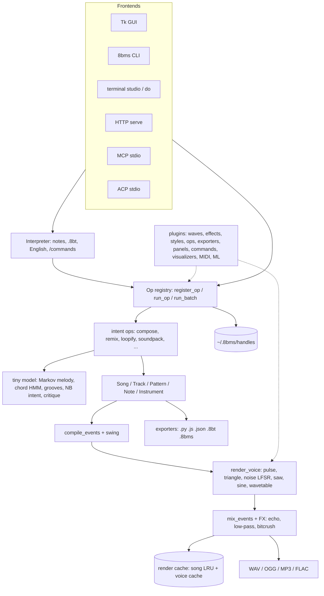

# Architecture

> **TL;DR** One file, `8BitMusicCodeStudio.py`, holds a GUI-free engine (model → sequencer → synth → mixer → exporters), an op registry on top of it, five front-ends that all call the registry, and a lazily-imported Tk GUI. `eightbit_studio` is a tiny import shim.

## Layers (top to bottom of the file)
1. **Constants and music theory:** PPQ 96, SR 44100, scales, chords, presets.
2. **Model:** `Instrument`, `Note`, `Pattern`, `Track`, `Song` dataclasses, with `to_dict`/`from_dict`.
3. **Synth and mixer:**
   - `osc`, `adsr_env`, `render_voice`, `mix_events`, effects.
   - Rendering is block-based (adaptive block size, 256 by default) with a two-level cache (song LRU of 6 + per-voice). `EIGHTBMS_NO_CACHE=1` disables it.
4. **Score language:** `parse_notes`, `apply_score`, `parse_score`, `song_to_score`.
5. **Generators and exporters:** styles, `generate_song`, Python/JS/JSON exporters, project I/O.
6. **Op registry:** `register_op`, `run_op`, `op_tools`, `openapi_spec`, schemas, `run_batch`, handles.
7. **Intent ops and ML:** compose and friends, the tiny model, critique, intent parser.
8. **Plugins:** manifest validation, loader, scaffolding, build/package.
9. **Front-ends:** MIDI, ACP, MCP, HTTP, terminal studio and visualizers.
10. **GUI** (`launch_gui`): imports tkinter only here.
11. **CLI** (`build_parser`, `main`).

## Design rules
- The engine never imports tkinter. Headless servers and CI need only NumPy.
- One registry: a new op (core or plugin) shows up in every front-end with no extra code.
- Deterministic by default: every random choice takes a seed.
- Files over memory: handles and sessions live under `EIGHTBMS_HOME`, so separate processes (CLI, MCP, HTTP) share them.
- Cross-platform: `pathlib` everywhere, UTF-8 file I/O, `winsound` and ANSI VT on Windows, no symlinks in the package.
